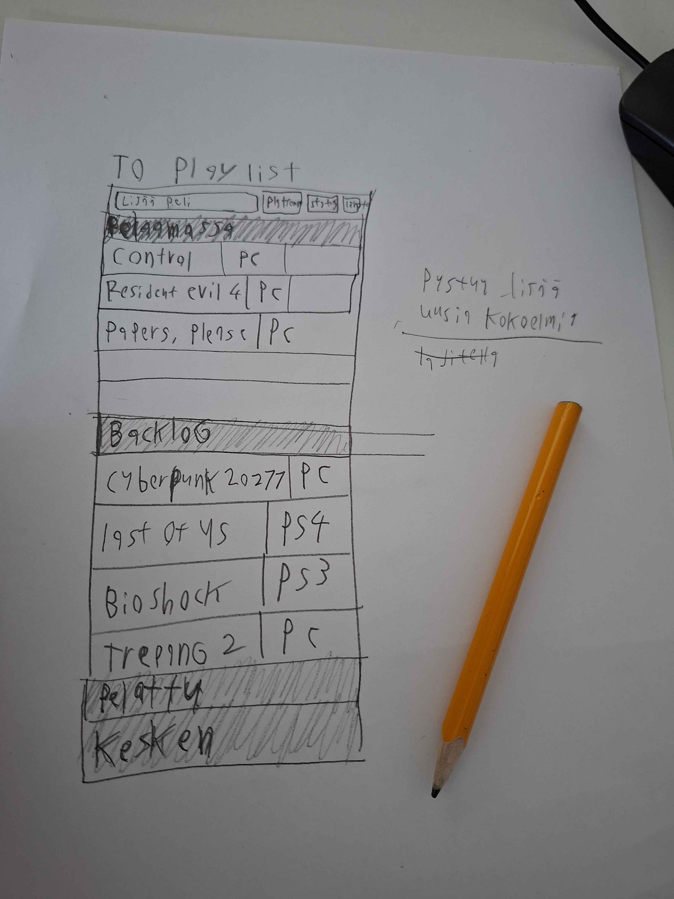
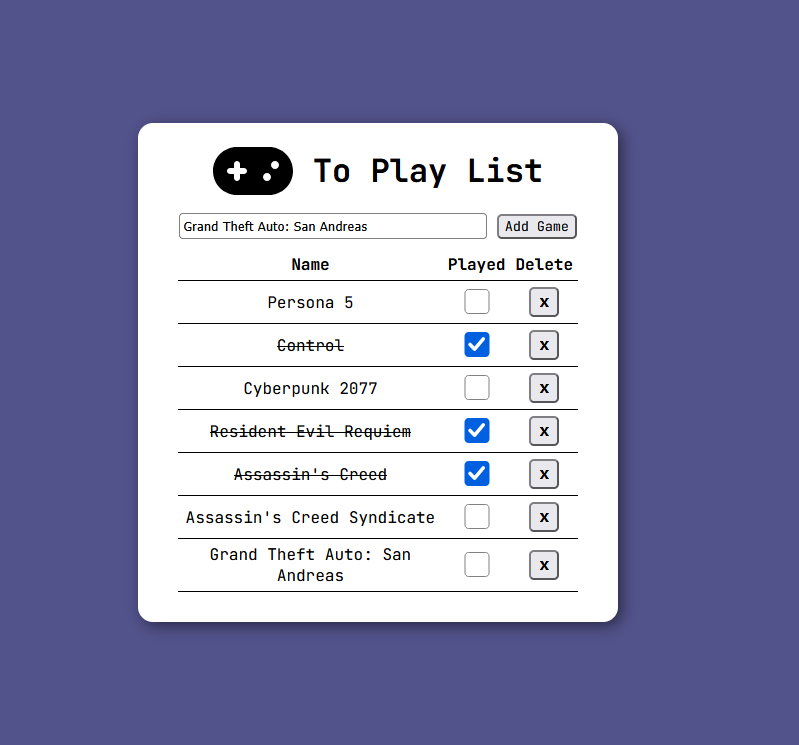

# To Play List

**Tekijä: Jere Peltonen**

## Projektisuunnitelma

### Projektin idea

Valitsin projekti ideaksi tehdä To do list sivun, mutta tekee sen pelaajille jotka pystyvät merkkaamaan mitä pelejä on pelannut.

### Suunnitellut toiminnot

- Pystyy lisäämään taulukkoon pelin
- Pelin voi poistaa taulukosta
- Pelin voi merkata pelatuksi jolloin line-through lisätään tekstin päälle.
- Sivu tallentaa käyttäjän sisällön localstoragen avulla?

### Rautalankamalli / luonnos

## Verkkolinkit

- **Julkaistu sovellus:** [To Play List](https://jerejpeltonen21.github.io/Projekti_1_DOM_Skriptaus/)
- **GitHub-repositorio:** [Projekti_1_DOM_Skriptaus](https://github.com/JereJPeltonen21/Projekti_1_DOM_Skriptaus)
- **Projektin videoesittely:** [Lisää tähän videon osoite](https://example.com/)

## Tietoja sovelluksesta

**[To Play List]** on verkkosovellus, jolla voi lisätä listalle pelejä, pelit voi joko merkata pelatuksi tai poistaa listalta.

## Teknologiat

- HTML – sivun rakenne
- CSS – ulkoasu ja asettelu
- JavaScript – toiminnallisuus, DOM-skriptaus ja lomakkeiden validointi
- localStorage – tietojen tallentaminen selaimeen, jos käytit sitä?

## Sovelluksen käyttö

Kirjoita lyhyet käyttöohjeet sovellukselle.

1. Avaa julkaistu sovellus yllä olevasta linkistä.
2. Täytä lomakkeen kenttä.
3. Lisää, poista tai merkitse kohteita tehdyiksi.
4. Päivitä sivu ja tarkista, säilyvätkö tiedot selaimessa, jos käytit localStoragea?

## Sovelluksen käynnistäminen paikallisesti

1. Kloonaa tai lataa tämä repositorio omalle koneellesi.
2. Avaa projektikansio.
3. Avaa `index.html` selaimessa.

## Kuvakaappaus

## Tunnetut virheet / puutteet

Tällä hetkellä kun kirjoitan tän, sovelluksesta puuttuu localstorage jonka avulla sovellus tallentaa käyttäjän lisäämät tiedot ja säilyy vaikka sivun sammuttaa tai päivittää, jos localstorage on saatu lisättyä niin tämä teksti poistetaan.

**Ei tunnettuja virheitä.**

## Oma arvio ja oppimisen reflektointi

- Missä onnistuin?
  - Sanoisin että onnistuin tekemään sivusto hyvin mielyttävän tyyleillä ja hyvin simppelin.

- Mikä oli haastavaa?
  - Isoin haaste mitä tuli oli saada validator toimimaan, jos lomakkeeseen kirjoitti tyhjää niin se joskus lähetti tyhjän rivin taulukkoon tai laittoi viestin että kirjoita jotain noin 2-3 klikkauksen jälkeen, lopulta insinööri kaveri löysi ratkaisun ja auttoi sen lisäämisessä.
- Mitä parantaisin, jos aikaa olisi enemmän?
  -
- Mitä opin HTML:stä, CSS:stä, JavaScriptistä ja DOM-skriptauksesta?
  - Tuli opittua enemmän javascriptiä mutta spesifisesti DOM-skriptausta jota oli kiva oppia ja mahdollisesti päästä käyttämään tulevissa projekteissa.

- Mitä lisäisin, jos aikaa olisi enemmän?
  - Olisin lisännyt enemmän ominaisuuksia esimerkiksi: taulukon sisältöä pystyy muokata, lisätä erillaisia kategoroita Backlog, Kesken, Lopetettu jne ja samalla pystyisi raahata rivin toiselle kategorialle.
  - Olisin myös kiva päästä kokeilemaan API ennen projekti 2 sillä olisi kätevää jos kirjoittaa lomakkeeseen niin hakee databasista pelin nimen ja listaa myös muita mahdollisia pelejä niin käyttäjä ei tarvitse kirjoitaa manuaalisesti pelin nimet.
  - Tekisin sivun toimimaan hyvin myös mobiili versiossa.

- Oma arvio projektista: **xx/10 pistettä**
  - Sain ainakin tehtyä kaikki pakolliset asiat niin arvioisin sen 9 pisteellä, jos saan vielä localstoragen lisättyä niin arvioisin sen tädellä 10 pisteellä.

## Lähteet ja kiitokset

Kiitokset menee mun Insinööri kavereille Juhana ja V jotka avustivat minua scriptien kanssa ja tarkoituksella ohjasivat niin että tulen vastauksiin omilla taidoilla eikä vaan he kirjoita mun puolesta.

- [w3school](https://www.w3schools.com/)
- [mdn_](https://developer.mozilla.org/en-US/)
  - Validator joka tarkistaa onko lomakkeessa mitään jolloin estää sen ja laittaa viestin siitä
  - (https://developer.mozilla.org/en-US/docs/Learn_web_development/Extensions/Forms/Form_validation)
- [Font Awesome](https://fontawesome.com/)
  - Peliohjain Iconi
  - (https://fontawesome.com/icons/classic/solid/gamepad)
- [Sitepoint Community](https://www.sitepoint.com/community/)
  - Iconi Headerin viereen
  - (https://www.sitepoint.com/community/t/image-next-to-header-better-way/362160)
- [Realtime Colors](https://www.realtimecolors.com)
  - Väri ja Fontti

## Lisenssi

Tämä projekti on lisensoitu MIT-lisenssillä.

Lisätietoa lisenssin lisäämisestä GitHub-projektiin:
https://docs.github.com/en/communities/setting-up-your-project-for-healthy-contributions/adding-a-license-to-a-repository